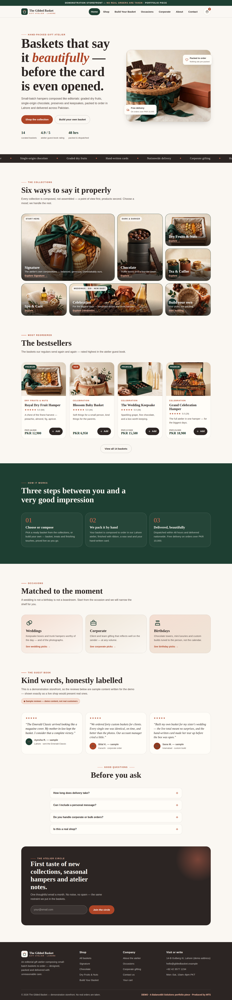

# Gift Basket E-Commerce Demo

**Portfolio Build Queue #2 — Multi-Talented Services (MTS)**
Owner of the queue: AICOS-116 (Portfolio Curator) · Repo & hosting: AICOS-114 (GitHub, Hosting & Deployment)

- **Industry / type:** Retail / gifts — full storefront demo
- **Design system:** Editorial Luxury (cream #FAF7F2 / terracotta #D96B52 / emerald #1E3F32 / charcoal #2C2523, + Bento Grid) (house systems owned by AICOS-112)
- **Key integrations (demo data):** Cart/checkout (demo), payment-gateway placeholders (PK route note), reviews, email capture
- **Built by:** AICOS-106 (E-Commerce Builds)
- **Pricing v3 mapping:** Shopify/E-commerce tiers

**Status: BUILT — v2, 2026-11-21 · Visual Quality Scorecard 81/100 (evidence bar; see repo files for the verdict)**

Rules for this repo: one repo per portfolio asset · hosted preview link (Netlify default) once built · this asset is a **DEMO** and is labelled DEMO wherever it is shown · integrations pre-wired with demo data only · QA pass by AICOS-115 before it is shown to any prospect.

---

## Preview — Full-Page Screenshots

**Desktop — full page:**

**Phone — full page:**

